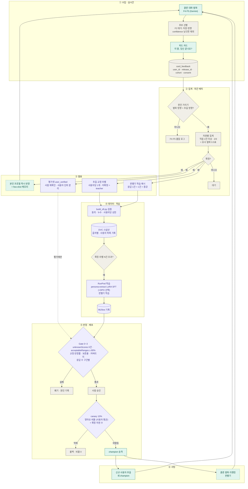

# 페르소나 확인 피드백 카드 — 학습 데이터 활용 정리

> 작성일: 2026-10-28 · 상태: 논의 정리 (팀 검토 전)
> 관련 문서: [V3 MLOps 구조 설계](https://claude.ai/artifact/DBccuQcULcp7gf4RNwW2y7) 14·15절, `docs/성능평가/03_F3_페르소나_추출_평가기준서.md`, `evals/quality_datasets/production_candidates_2026-10-27/README.md`

---

## 핵심 요약 (Executive Summary)

- **카드가 하는 일**: 홈피드 중간에 사용자 A의 클론이 다른 사용자와 대화하며 한 말을 보여 주고 "이 말, 당신 같나요? (맞아요 / 아니에요)"를 묻는다.
- **이 데이터의 진짜 가치는 양이 아니라 라벨의 출처다.** teacher 라벨과 사람 검수자는 "원문에 근거가 있는가(근거 정합성)"만 판정한다. "이 사람이 실제로 그런가(본인 타당성)"는 본인만 판정할 수 있고, 카드가 이 축을 처음 파이프라인에 들여온다.
- **추출(F3)에 쓰면 "성능을 올린다"가 아니라 "과잉 단정을 줄인다"가 정확한 표현이다.** 아니에요는 틀렸다는 것만 알려 주고 맞는 값은 알려 주지 않으므로, 정밀도는 오를 수 있지만 정확도는 오르지 않고 커버리지는 내려간다.
- **추출 쪽에서 카드 데이터는 학습용으로는 약하고 평가용으로는 강하다.** 확실한 용도는 ① 추출의 본인 일치도 평가, ② 응답한 사용자 본인 프로필 즉시 교정이다. ③ 학습 효과는 실험으로 확인해야 하는 가설이다.
- **라벨 단위(발화)와 가장 잘 맞는 대상은 클론 발화 생성이다.** "본인다움 판별기 + 클론 발화 리랭킹·few-shot"으로 쓰면 응답 1건이 학습 예시 1건이 되고, Gemini를 학습하지 않으므로 기존 결정("대화 생성은 학습하지 않는다")과 충돌하지 않는다.
- **좋아지는 기능을 쉽게 말하면**: "내 클론이 다른 사람과 대화할 때 진짜 나처럼 말하는 것."
- **사용자별 파일·모델은 필요 없다.** 데이터는 DB 테이블 하나에 `user_id`로 쌓고, 모델은 전체가 하나를 쓴다. 새로 생기는 의무는 탈퇴·동의 철회 시 삭제와 재학습 제외다.
- **가장 큰 위험은 응답 많은 사용자 쏠림(사용자 단위 편향)**이다. 사용자당 상한, 사용자 단위 평균, "피드백 없는 신규 사용자" 기준 평가로 막는다.
- **현재 상태**: 피드백 데이터 0건, 실험 0회, MLOps 루프(M0~M5) 미구현, `persona-extract` 미학습. 아래 모든 효과는 측정 전 가설이다.

---

## 파이프라인 플로우 차트

- 색: 초록 = 사용자 접점 · 서빙, 보라 = 학습 · 평가, 회색 = 집계 · 판정 · 실패 처리
- 점선 테두리 = 제안 단계 (팀 결정 전): 즉시 반영 · few-shot, 판별기, 발화 리랭킹
- 평가셋(`user_verified`)은 학습에 들어가지 않고 게이트에서만 쓴다



| 구간 | 주기 | 사람 개입 |
|---|---|---|
| ① 수집 | 실시간 | 없음 |
| ② 집계 · ③ 활용 | 야간 배치 | 평가셋 표본 재확인 |
| ④ 데이터 · 학습 | 확정 라벨 N건 초과 시 (첫 2회 수동) | 없음 |
| ⑤ 판정 · 배포 | 학습 후 | 승격 승인 |
| ⑥ 서빙 | 상시 | 없음 |

---

## 1. 배경과 현재 상태

### 1.1 카드 흐름

1. AI 서버가 클론 발화 중 개인 특성이 잘 드러나는 발화를 고른다 (F2 태거로 차원·방향을 붙임).
2. 홈피드 중간에 카드로 노출한다. 상대방 발화와 상대를 알아볼 수 있는 정보는 지우고 클론의 한 문장만 보여 준다.
3. 사용자가 맞아요 / 아니에요로 답한다.
4. 응답을 집계해 확정 판정을 만들고, 학습·평가·프로필 교정에 쓴다.

### 1.2 태깅·추출의 위치

- 태깅(F2)과 추출(F3)은 **온보딩 단계에서만** 쓰인다.
- 한 사람의 문답을 그 사람에게만 적용하는 **개인 단위 처리**다.
- 추출 출력: 차원별 0~100 점수(`avoidance`, `disclosure`, `openness` 등 15개), 관심사·일상·데이트 선호 목록, 서술(narrative). 근거 없는 차원은 비워 둔다 (`RawExtraction`, `app/features/persona/schemas.py`).

### 1.3 현재 상태 (As-Is)

| 항목 | 상태 |
|---|---|
| 카드 피드백 데이터 | 0건 |
| 카드 데이터로 한 실험 | 0회 |
| `persona-extract` 어댑터 | 미학습 (기본 모델로 추출) |
| MLOps 단계 M0~M5 | 미구현 (설계만 있음) |
| 사람 골드셋 `human/` | 0건 |
| 2026-10-27 운영 결함 탐지 | 관찰 82개(태깅 72, 추출 10) 중 우선 검수 대상 고유 관찰 18개. 사람 확정 전 |

---

## 2. 라벨의 출처: 두 개의 축

| 축 | 질문 | 누가 판정하나 | 지금 있나 |
|---|---|---|---|
| 근거 정합성 | 원문 근거로 이 값이 나오는가 | teacher(Qwen3.8-27B), 사람 검수자 2인 | 있음 (teacher 라벨, 골드셋 작업 중) |
| 본인 타당성 | 이 사람이 실제로 그런가 | 본인만 가능 | **없음 → 카드가 처음 들여옴** |

- 카드 데이터는 사람 2인 검수를 대체하지 않는다. 다른 축을 보완한다.
- 본인 응답이 곧 진실이라는 보장은 없다 (이상적 자아 편향, 6절).

---

## 3. 결정 상태 분류

### 3.1 확정 (설계 문서 14·15절에 결정으로 기록)

- 피드백은 `persona-extract`(F3 추출) 교정에만 쓴다. 대화 생성·태깅은 학습하지 않는다.
- 맞아요 확정 → 점수 유지(확인됨 표시). 아니에요 확정 → 그 차원 null. 목록 항목은 아니에요 확정 시 삭제.
- 유사 발화는 같은 사용자 · 같은 차원 안에서만 약한 표(0.5)로 센다. 약한 표만으로는 확정하지 않는다.
- 학습 예시: 입력 = 온보딩 답변 · 말투 샘플, 정답 = 교정 라벨. 지금 추출 스키마 그대로.
- 동의(`consent_basis`)가 없으면 학습에 쓰지 않는다.

### 3.2 초안 (값 미정)

| 항목 | 현재 초안 | 정하는 시점 |
|---|---|---|
| 확정 기준 | 직접 응답 2건 이상, 한쪽 2/3 이상 | 첫 집계 후 |
| 유사 발화 임계값 τ | 미정 | 유사 발화 표 정밀도 측정 후 |
| 재학습 트리거 건수 N | 미정 | 첫 2회 수동 실행 후 |
| canary 판정 기간 | 최소 500건 또는 7일 중 늦은 쪽 | 운영 후 조정 |

### 3.3 제안 (이번 논의에서 나온 것, 팀 결정 아님)

- 응답한 사용자 본인 프로필에 확정 판정 즉시 반영
- 미확정 차원은 teacher 라벨로 채움
- 추출 출력 단위 DPO 선호쌍
- 사용자당 반영 상한, 응답 수 구간별 평가, 사용자 단위 평균(macro)
- 확정 성향 조건 합성, 능동 선택, 회귀 문항화
- 여러 사용자에게서 반복된 교정만 학습 가중치 부여
- 본인다움 판별기 + 클론 발화 리랭킹·few-shot (8절)

### 3.4 모호 (모름 · 미검증)

- 추출 정확도가 실제로 오르는지 — 데이터·실험 없음
- null 학습이 신규 사용자 정밀도를 올리는지, 커버리지만 깎는지
- 응답률과 데이터 양
- F2 태거가 클론 대화 발화에서도 정확한지 — 측정한 적 없음
- 원인 가리기가 추출 오류와 생성 오류를 실제로 가르는지 — 방향이 같아도 말투 때문에 아니에요가 나올 수 있음
- 사용자 응답이 사실인지 — 이상적 자아 편향
- 클론 대화·리포트가 간접적으로 좋아지는지 — 추론일 뿐 측정 계획 없음
- 응답 이벤트 저장 위치 (BE DB / Langfuse)
- 동의 방식 — 기획·법무 확인 필요
- `build_sft.py`가 동의 없는 데이터를 막는다는 내용 — 설계 문서 기술, 코드 미확인
- 매칭·추천에 쓸 수 있는지 — 매칭 로직은 BE 쪽, 미확인

### 3.5 아니다 (오해하기 쉬운 것)

| 오해 | 사실 |
|---|---|
| 호불호 1건이 바로 학습 데이터가 된다 | 집계로 확정된 판정만 쓴다 |
| 태깅(F2)이 좋아진다 | 카드 응답은 태깅을 판정하지 않는다. 학습하지 않는다 |
| 대화 생성 모델(Gemini)이 좋아진다 | 학습하지 않는다. 리랭킹·few-shot은 Gemini를 바꾸지 않는다 |
| 틀린 차원의 맞는 값을 알게 된다 | 비울 뿐이다. 값까지 고치려면 후속 카드가 필요하다 |
| 추출용 데이터가 많이 늘어난다 | 추출은 사용자당 예시 1개다. 늘리는 방법(합성)은 제안 단계다 |
| 모델이 A라는 사람을 기억해 개인화한다 | 개인화는 입력에 있고, 모델은 규칙을 배운다. 다만 학습 텍스트 암기 가능성이 0은 아니다 |
| 지금 이 루프가 돌아간다 | M0~M5 미구현. "사람은 승인만"은 목표 상태다 |
| 사용자별 파일·모델을 따로 관리해야 한다 | DB 테이블 하나, 모델 하나 |

---

## 4. 추출(F3) 교정에 쓰는 방식

### 4.1 응답을 교정 정답으로 바꾸는 규칙

| 단계 | 규칙 | 이유 |
|---|---|---|
| 후보 선별 | 클론 발화를 F2 태거로 태깅해 차원·방향을 붙인다. 차원이 안 잡히는 발화는 카드로 쓰지 않는다 | 응답을 특정 차원에 연결해야 정답으로 쓸 수 있다 |
| 원인 가리기 | 발화 방향이 그 사용자의 추출 점수 방향과 같을 때만 추출 판정으로 센다. 다르면 F4·F5 품질 로그로 보낸다 | 아니에요가 추출 탓인지 생성 탓인지 구분 |
| 차원별 집계 | 사용자 × 차원마다 직접 응답 2건 이상, 한쪽 2/3 이상일 때 확정 | 실수 클릭 한 번으로 라벨이 바뀌지 않게 |
| 유사 발화 표 | 같은 사용자 · 같은 차원에서 KURE-v1 임베딩이 τ 이상 가까운 발화는 0.5표 | 묻는 횟수를 늘리지 않고 근거를 보탬 |
| 교정 라벨 | 맞아요 → 유지, 아니에요 → null, 목록 항목 → 삭제 | 아니에요는 맞는 값을 알려 주지 않는다. C4(값 지어내지 않기) 규칙과 같은 방향 |
| 학습 예시 | 입력 = 온보딩 답변 · 말투 샘플, 정답 = 교정 라벨 | 지금 추출 프롬프트·스키마 그대로 |

### 4.2 지표별로 무엇이 좋아지나

| 지표 | 방향 | 이유 |
|---|---|---|
| 정밀도 (근거 없는 특성 생성, C4) | ↑ 가능 (미검증) | 아니에요 → null 교정이 겨냥하는 대상 |
| 정확도 (맞는 값을 맞히기) | 변화 없음 | 아니에요는 맞는 값을 모르고, 맞아요는 새 정보가 없다 |
| 커버리지 (채워진 차원 수) | ↓ | 비우는 학습이다 |
| 기존 F3 지표 (`acceptableRanges` 등) | 유지 목표 | 올리는 대상이 아니라 지키는 대상 |

- 겨냥하는 결함 예: 2026-10-27 탐지의 "자음 답변 → `disclosure=70` · 성향 서술", "외모·음주 답변뿐인데 `seriousness=20`".

### 4.3 효과가 나타나는 두 층

| 층 | 대상 | 시점 | 방법 |
|---|---|---|---|
| 본인 프로필 교정 | 응답한 사용자 A | 즉시 (학습 불필요) | 확정 판정을 A 프로필에 반영 → A의 클론이 그 특성으로 말하지 않음 (제안, 설계 문서에 아직 없음) |
| 추출 모델 개선 | 앞으로 들어올 신규 사용자 | 재학습 후 | 교정 라벨로 `persona-extract` 학습 |

- 신규 사용자는 카드 응답이 하나도 없는 상태로 온보딩 추출을 받는다. 그래서 신규 사용자에게는 학습된 모델이 유일한 개선 경로다.

### 4.4 학습 데이터 vs 평가 데이터

| 용도 | 평가 | 이유 |
|---|---|---|
| 학습 데이터 | 약함 | 사용자당 확정 차원이 적다. 대부분 부정 신호다. 응답자 편향·클릭 노이즈·이상적 자아 편향 |
| 평가 데이터 | 강함 | 본인 타당성의 유일한 출처. 추출이 어느 차원에서 지어내는지 바로 측정. canary 온라인 지표 |

### 4.5 개인 데이터가 전체 모델에 영향을 주는 원리

- 모델 가중치에는 사람별 정보가 없다. **답변 텍스트를 특성 점수로 바꾸는 규칙(함수) 하나**만 있다.
- 개인화는 **입력**에 있다. A의 결과가 A다운 것은 A의 답변이 들어갔기 때문이다.
- 교정은 이 규칙을 고친다. 그래서 비슷하게 답하는 B, C의 결과도 바뀐다. 이것이 의도다.

예시:

```
A 온보딩 답변: "주말엔 그냥 집에 있어요"
기존 추출:     openness=20, 서술 "새로운 걸 꺼림"
A 피드백:      클론 발화 "새로운 데는 별로예요" → 아니에요 (확정)
교정 예시:     입력 = A 답변, 정답 = openness null
모델이 배우는 것: "집에 있다"만으로는 openness를 낮게 매길 근거가 안 된다
```

- **null 교정은 퍼져도 상대적으로 안전하다.** 새 값을 만들지 않으므로, A만의 사정이 B에게 잘못 옮겨가도 B의 최악은 "값이 비는 것"이다. 대가는 커버리지 하락이다.
- **위험한 경우**: 한 사람만의 특수 패턴이 규칙이 될 때 (예: 실제로는 모험적인데 그날 피곤해서 "집에 있어요").
  - 대응 1: 같은 답변 패턴 → 같은 교정이 **서로 다른 여러 사용자**에게서 나올 때만 학습 가중치를 준다.
  - 대응 2: **학습에 안 들어간 사용자**로 평가한다.

---

## 5. MLOps 자동화에서의 학습 흐름

사람의 개입은 승인 버튼과 평가셋 표본 확인뿐이다. 나머지는 자동이다 (목표 상태).

| 단계 | 주기 | 하는 일 | 산출물 |
|---|---|---|---|
| 1. 수집 | 실시간 | 카드 응답 이벤트 저장 | 응답 이벤트 |
| 2. 집계 | 야간 배치 | 원인 가리기, 차원별 확정, 약한 표, A 프로필 즉시 반영(제안) | 확정 판정 |
| 3. 라벨 생성 | 야간 배치 | 사용자 1명당 예시 1개 | 교정 예시 (+ DPO 쌍, 선택) |
| 4. 검증 · 스냅샷 | 야간 배치 | `build_sft.py` 검사, 출처별 DVC 스냅샷 | `dataset@<hash>` |
| 5. 재학습 트리거 | 확정 라벨 N건 초과 | `model-pipeline.yml` 실행 (첫 2회 수동) | — |
| 6. 학습 | 트리거 시 | RunPod LoRA SFT (DPO 선택), MLflow 기록 | `adapter@<run_id>` |
| 7. 오프라인 게이트 | 학습 후 | candidate vs champion, 같은 평가셋 | 평가 리포트 |
| 8. 승인 · canary | 사람 승인 후 | canary 10%, 사용자 해시 고정 배정 | champion 승격 또는 롤백 |
| 9. 루프 | 상시 | 새 champion이 신규 사용자 추출 → 클론 대화 → 다시 카드 | — |

### 5.1 응답 이벤트 예시

```json
{"user_id": "u_A", "utterance_id": "...", "trace_id": "...",
 "dimension": "openness", "direction": "low",
 "answer": "no", "release_id": "ai-2026.11.0", "cohort": "champion",
 "consent_basis": "..."}
```

- `dimension`·`direction`: 카드 선택 시 F2 태거가 붙인 값
- `release_id`·`cohort`: 어느 모델의 추출에 대한 판정인지 추적

### 5.2 교정 학습 예시

```
입력:  A의 온보딩 답변 + 말투 샘플   (지금 추출 입력 그대로)
정답:  맞아요 확정 차원   → 원래 점수 유지
       아니에요 확정 차원 → null
       미확정 차원        → teacher(Qwen) 라벨
```

- DPO(선택): chosen = 교정 정답, rejected = 당시 추출 출력
- 출처 비율: user_feedback은 소량, teacher·합성이 기반

### 5.3 `build_sft.py` 통과 조건

- `consent_basis` 있음
- `source=user_feedback`
- 집계 기준 통과
- 평가셋과 누수 없음
- 사용자 단위 분리
- 사용자당 상한 이내

---

## 6. 교정 효과를 재는 지표

### 6.1 학습 전 — 현재 champion의 성적표 (기준선)

| 지표 | 계산 | 의미 |
|---|---|---|
| 본인 확인 정밀도 (차원별) | 맞아요 확정 ÷ (맞아요 + 아니에요 확정) | 추출값 중 본인이 인정한 비율 |
| 아니에요 확정률 (차원별) | 아니에요 확정 ÷ 확정 전체 | 어느 차원에서 지어내는지 (C4 계열) |
| 확신도 보정 오차 (ECE) | confidence HIGH/MEDIUM/LOW별 맞아요 비율 | 높은 확신일수록 실제로 더 맞는지 |

### 6.2 학습 후 오프라인 — candidate vs champion

평가셋: 학습에 쓰지 않은 사용자의 `user_verified` 묶음 (사람이 다시 확인한 사용자 확정 라벨만, 유사 발화 표로 확정된 라벨은 제외).

| 지표 | 기대 방향 | 기준 |
|---|---|---|
| 교정 반영률 (아니에요 확정 차원을 비운 비율) | ↑ | 핵심 지표 |
| 확정값 보존율 (맞아요 확정 차원을 같은 구간으로 유지한 비율) | 유지 | 구간: 낮음 0~34 · 중간 35~64 · 높음 65~100 |
| 본인 확인 정밀도 | ↑ | — |
| 차원 커버리지 | 소폭 ↓ 허용 | 크게 떨어지면 과잉 비움 |
| `unknownScores` (E3-CRIT-01) | 유지 | 0건 |
| `acceptableRanges` | 유지 | 80% 이상 |

- **모델 점수(raw JSON)로 잰다.** 제품 점수는 `service.py`가 미답변 차원을 사후 null 처리한 값이라 교정 효과가 가려진다 (F3 기준서 1.2절).

### 6.3 운영 canary

| 지표 | 기대 방향 | 비고 |
|---|---|---|
| 맞아요 비율 (사용자 단위 평균) | ↑ | 응답 수 구간별로도 따로 |
| 사용자당 맞아요 확정 차원 수 | 유지 또는 ↑ | 아래 함정을 막는 짝 지표 |
| 원인 가리기 비율 (생성 쪽 원인) | 변화 없음 | 늘면 대화 프롬프트 문제 |

- **맞아요 비율의 함정**: 새 모델이 차원을 많이 비우면 비운 차원은 카드에서 빠진다. 자신 있는 차원만 카드로 나가 맞아요 비율이 저절로 오른다. 그래서 확정 차원 수와 같이 봐야 한다.

### 6.4 함께 볼 운영 지표

| 지표 | 쓰는 곳 |
|---|---|
| 카드 응답률 | 노출 빈도 조정 |
| 재노출 일관성 (같은 문장에 같은 답) | 응답 품질 필터 |
| 유사 발화 표 정밀도 | τ 조정 |
| 방향별 아니에요 비대칭 | 이상적 자아 편향 감지 |

---

## 7. 위험과 대응

### 7.1 일반 위험

| 위험 | 증상 | 대응 |
|---|---|---|
| 과잉 비움 | null 예시만 쌓여 모델이 차원을 다 비움 | 차원 커버리지 감시, 맞아요 확정 예시와 비율 맞추기 |
| 이상적 자아 편향 | 덜 좋아 보이는 특성은 사실이어도 아니에요 | 사용자별 맞아요 기본율 보정, 방향별 비대칭이 큰 차원은 사람 확인 전 학습 제외 |
| 무난한 발화 | 누구에게나 맞는 말은 정보가 없음 | 점수가 중간(35~64)인 차원은 우선순위 낮춤, 높음·낮음을 분명히 드러내는 발화 먼저 |
| 태거 오류 · 입력 분포 변화 | 태거는 온보딩 답변에만 써 왔는데 클론 대화 발화를 태깅함 | 클론 발화 소량을 사람이 라벨링해 정확도 측정, 태깅 confidence 낮은 발화 제외 |
| 사용자 단위 누수 | 같은 사용자 라벨이 학습·평가 양쪽에 | 사용자 단위 분리 |
| 피드백 루프 쏠림 | canary 추출로 만든 발화만 확인받음 | champion 그룹 발화 일정 비율 유지 (`cohort`) |

### 7.2 사용자 단위 편향 — 응답 많은 사용자 쏠림

개인 단위 문답을 어댑터 하나의 학습에 모으면, 응답을 많이 한 소수 사용자의 답변 방식과 성향 분포 쪽으로 모델이 기운다. 추출은 사용자당 예시 1개라서 편향은 예시 수보다 아래 경로로 들어온다.

| 경로 | 어떻게 기우나 | 대응 |
|---|---|---|
| 누가 라벨을 갖나 | 적극 응답자가 특정 성향에 몰림 | 피드백 보유 사용자 vs 전체 사용자 분포 비교 리포트, 차이 크면 재가중 |
| 확정 차원 수 | 많이 답할수록 검증된 정답이 몰림 | 미확정 차원은 teacher 라벨, 사용자당 가중치 상한 |
| 유사 발화 약한 표 | 대화 많은 클론일수록 표가 빨리 쌓임 | 약한 표 수 ≤ 직접 응답 수 |
| 합성 증강 | 확정 많은 사용자에게서 합성이 많이 나옴 | 사용자당 합성 상한, 차원 × 방향 균형 샘플링 |
| 재학습 누적 | 같은 예시가 스냅샷마다 반복 | 사용자 기준 중복 제거, 최신 판정 하나만 |
| 노출 단계 | 자주 접속하는 사용자가 카드를 더 봄 | 사용자당 일·주 노출 상한 |
| 온라인 판정 | 응답 건수 합산 시 헤비 유저가 판정 좌우 | 사용자 단위 평균, 응답 수 구간별 확인 |

**평가 원칙**: "피드백이 없는 사용자"를 기준으로 한다. 응답 수 구간별로 지표를 내고, 적게 응답한 구간에서 champion보다 떨어지지 않아야 승격한다.

| 응답 수 구간 (예시) | 용도 |
|---|---|
| 1~2건 | 승격 판단의 기준 구간 |
| 3~9건 | 비교 |
| 10건 이상 | 헤비 유저 쏠림 감지 |

---

## 8. 추출 외 기능으로 확장

카드 응답은 **발화 하나**에 대한 판정이다. 발화를 만드는 쪽에 쓰면 원인 가리기 없이 라벨이 그대로 맞는다.

### 8.1 기능별 가능 여부

| 기능 | 가능 여부 | 방법 | 학습 필요 |
|---|---|---|---|
| 클론 발화 생성 (F4·F5) | **가능 (가장 직접적)** | few-shot, 리랭킹, 프롬프트 버전 비교 | Gemini 학습 없음 |
| 본인다움 판별기 (신규) | **가능 (학습 데이터로 가장 잘 맞음)** | (프로필, 발화) → P(맞아요) | 판별기만 학습 |
| F1 온보딩 질문 배분 | 가능 | 아니에요가 잦은 차원에 질문 더 배분 | 없음 (정책 변경) |
| F6 리포트 · 요약 카드 | 약함 | 맞아요 확정 특성 우선 서술 | 없음 |
| F2 태깅 | **아니다** | 카드가 태깅을 판정하지 않음 | — |
| 매칭 · 추천 | 모호 | 확정 차원만으로 매칭 가중치 | BE 로직 미확인 |

### 8.2 클론 발화 생성에 쓰는 세 가지 방법

- **본인 발화 few-shot**: A가 맞아요 한 발화를 페르소나 메모리에 저장하고 클론 프롬프트에 "이렇게 말함" 예시로, 아니에요 한 발화는 "이렇게 말하지 않음"으로 넣는다. 학습 없이 A에게 바로 개인화된다.
- **리랭킹**: 발화 후보 N개를 생성하고 판별기가 본인다움 점수가 가장 높은 것을 고른다.
- **프롬프트 버전 비교**: 프롬프트 버전별 맞아요 비율로 게이트를 건다. 기존 프롬프트 게이트 구조에 지표만 추가한다.

### 8.3 쉽게 설명하면

- **좋아지는 기능**: 내 클론이 다른 사람과 대화할 때 진짜 나처럼 말하는 것.
- **지금**: 클론은 온보딩 프로필만 보고 말해서 가끔 "나라면 저런 말 안 하는데" 싶은 말을 한다. 상대는 그 클론을 보고 나를 판단한다.
- **카드 이후**:
  1. 내가 맞아요 한 말투를 따라 하고, 아니에요 한 말은 피한다.
  2. 할 말을 여러 개 만들어 두고 가장 나다운 말을 고른다.
  3. 판별기는 모든 사용자 데이터로 배우므로, 카드에 답한 적 없는 신규 사용자의 클론도 덜 엉뚱해진다.
- **비유**: 이력서만 보고 소개팅에 나간 대리인 → 내가 "그 말은 나다웠어 / 그건 아니야"라고 피드백을 준 대리인.
- **사용자 체감**: 내 클론 대화를 봤을 때 "이거 나 같다"는 느낌이 늘고, 상대는 실제 나와 더 비슷한 클론과 대화한다.
- **단, 가설이다.** 맞아요 비율이 오르는지 실험으로 확인해야 한다.

### 8.4 본인다움 판별기 상세

| 항목 | 내용 |
|---|---|
| 입력 | 발화한 클론 주인의 프로필 + 클론 발화 |
| 출력 | P(맞아요) |
| 학습 예시 수 | 응답 1건 = 예시 1건 (추출은 사용자당 1건) |
| 초기 형태 | KURE-v1 임베딩 + 작은 분류기 → 부족하면 Kanana LoRA 분류기 |
| 쓰는 곳 | 발화 리랭커, 오프라인 자동 평가(11 문서 P1 당사자 유사성), 카드 후보 선별 |
| 결정 필요 | 설계 문서의 자체 모델 범위(태깅·추출·VLM) 확장 |

**"이런 프로필"이 뜻하는 것**

- 프로필 = **그 발화를 한 클론의 주인, 곧 카드에 답한 사람 본인의 추출 결과**. 판별기는 이름·신원이 아니라 점수 패턴을 본다.
- 발화자 = 프로필 주인 = 응답자 = 같은 사람 A. 예외는 증강의 "프로필 교차"뿐이다.

```
프로필:  A의 추출 결과   (openness=20, disclosure=75, ...)
발화:    A 클론이 한 말   "처음 가는 곳은 좀 부담돼요"
라벨:    A의 응답         맞아요
```

- 판별기가 배우는 "이런 프로필"은 특정 한 사람도, 전체 사용자도 아니다. **해당 차원 점수가 비슷한 사람들의 묶음**이다.
  - openness 낮은 사용자 여러 명이 비슷한 발화에 맞아요 → "openness 낮은 프로필에는 이런 말이 어울린다"
  - 신규 사용자 C의 openness가 낮으면 같은 규칙 적용, 높으면 낮은 점수
- **한계**
  - 데이터에 자주 나오는 점수 패턴에만 잘 맞는다. 드문 조합은 판단이 약하다.
  - 헤비 유저 성향이 많으면 그쪽 패턴만 잘 배운다 (7.2절과 같은 문제).
  - 처음에는 입력을 **차원 점수 + 발화의 태깅 차원**으로 단순하게 둔다. 서술·관심사까지 넣으면 패턴이 너무 잘게 쪼개진다.

### 8.5 판별기 증강

| 방법 | 만드는 법 | 라벨 | 자동 검증 |
|---|---|---|---|
| 프로필 교차 | A의 맞아요 발화 + 그 차원 방향이 반대인 B의 프로필 | 아니에요 | B의 해당 차원이 반대 구간일 때만 |
| 방향 뒤집기 | LLM이 맞아요 발화의 특성 방향만 반대로 다시 씀 | A에게 아니에요 | F2 태거로 방향이 실제로 뒤집혔는지 확인 |
| 의미 보존 바꿔 쓰기 | 맞아요 발화를 같은 뜻으로 바꿔 씀 | A에게 맞아요 | 태거 방향 동일 + 임베딩 거리 τ 이내 |
| 유사 발화 약한 표 | 기존 규칙 | 0.5 가중치 | 같은 사용자 · 같은 차원 안에서만 |

**증강 규칙**

- 합성 라벨은 "뒤집으면 아니에요일 것"이라는 **가정**이다. 평가셋에 절대 넣지 않는다.
- 평가는 실제 카드 응답으로만, 사용자 단위로 분리해서 한다.
- 합성을 넣었을 때 실제 평가셋 성능이 오르는지 비교한다. 오르지 않으면 버린다.
- 사용자당 합성 상한을 둔다.

### 8.6 추출용 증강 (참고)

| 방법 | 규칙 | 상태 |
|---|---|---|
| 유사 발화 약한 표 | 같은 사용자 · 같은 차원 0.5표 | 확정 |
| 능동 선택 | confidence `LOW`·`MEDIUM` 차원과 응답이 갈린 차원을 드러내는 발화를 먼저 카드로 | 제안 |
| 확정 성향 조건 합성 | 확정 판정을 조건으로 `generate_synthetic_onboarding.py`가 합성 온보딩 생성. `source=synthetic_from_feedback`, 평가셋 제외, 누수 검사(SequenceMatcher 0.76, 3-gram Dice 0.45) | 제안 |
| 회귀 문항화 | 사람이 재확인한 아니에요 사례를 원문 복사 없이 합성 입력으로 바꿔 regression에 추가. blind_holdout 금지 | 제안 |
| 하지 않는 것 | 발화 단위 KTO/DPO, 반대 성향 발화 생성 쌍으로 대화 생성 모델 학습 | 제외 (14절 결정) |

---

## 9. 데이터 관리

### 9.1 사용자별 파일·모델은 필요 없다

- **개인 데이터 = DB 행.** 프로필과 페르소나 메모리(PostgreSQL + pgvector)는 이미 사용자별 행이다 (설계 문서 12절 기준, 코드 미확인). 카드 응답 테이블 하나를 추가한다.

  ```
  card_feedback(user_id, utterance, dimension, direction, answer, created_at, consent_basis)
  ```

- few-shot은 `user_id`로 맞아요 발화 상위 몇 개를 조회한다. 사용자당 많아야 수십 행이다.
- **모델 = 전체 공용 하나.** 입력에 프로필이 들어가 개인별로 판단한다. 사용자별 LoRA는 비용이 크고 데이터 몇 건으로는 학습되지 않으므로 만들지 않는다.

### 9.2 새로 생기는 의무: 삭제

- 탈퇴·동의 철회 시 `card_feedback`에서 그 사용자의 행을 지운다.
- 이미 학습된 판별기·추출 모델에는 데이터가 남는다. **다음 재학습 때 그 사용자를 빼고 학습**한다.
- 이를 위해 **스냅샷마다 포함된 사용자 목록을 기록**한다.
- 삭제 규칙은 동의 방식과 함께 기획·법무와 확정한다.

---

## 10. 결정이 필요한 것

| 항목 | 선택지 | 제안 |
|---|---|---|
| 피드백 데이터의 학습 대상 (재결정) | A. 추출만 (현재 확정) / B. 추출 + 판별기 · 발화 리랭킹 | B 검토. 추출은 평가 + 본인 프로필 교정 중심 |
| 본인다움 판별기 도입 | 도입 / 보류 | 도입 시 자체 모델 범위 확장 결정 필요 |
| 본인 프로필 즉시 반영 | 반영 / 학습 라벨로만 | 반영 |
| 피드백 학습 방식 (추출) | SFT 교정만 / SFT + DPO | SFT 먼저, DPO는 라벨이 쌓인 뒤 비교 |
| 확정 성향 조건 합성 | 허용 / 금지 | 허용하되 출처 분리 · 평가셋 제외 · 누수 검사 통과분만 |
| 사용자당 반영 상한 | 없음 / 예시 1개 + 가중치 · 약한 표 · 합성 상한 | 상한 두기. 값은 첫 집계의 응답 수 분포를 보고 결정 |
| 반복 교정 조건 | 한 사용자 판정도 반영 / 여러 사용자 반복 시만 가중치 | 여러 사용자 반복 시만 (설계 문서에 아직 없음) |
| 응답 이벤트 저장 위치 | BE DB / Langfuse score | 미정 |
| 동의 방식 | 가입 약관 / 카드 첫 노출 시 별도 동의 | 기획 · 법무 확인 |
| 삭제 정책 | — | 탈퇴 시 행 삭제 + 다음 재학습 제외 |
| 후속 카드 ("어느 쪽에 더 가까워요?") | 넣기 / 안 넣기 | 첫 버전 제외, 응답률 본 뒤 결정 |

---

## 11. 발표용 문장

- ❌ "카드로 추출 성능을 올린다" — 근거가 약하다.
- ✅ "카드로 추출의 본인 일치도를 측정하고, 틀린 단정을 교정한다. 학습 효과는 실험으로 확인한다."
- ✅ (판별기 방향 채택 시) "사용자가 직접 '나답다/아니다'를 판정한 발화로 본인다움 판별기를 학습해, 클론이 더 그 사람답게 말하도록 발화를 고른다."

---

## 부록. 논의 중 바뀐 점

| 처음 의견 | 바뀐 결론 | 이유 |
|---|---|---|
| 발화 단위 KTO/DPO로 학습 | 추출 쪽에서는 제외 | 14절 결정이 "대화 생성은 학습하지 않음" |
| 카드로 추출 성능 향상 | "과잉 단정 감소"로 축소 | 아니에요는 맞는 값을 알려 주지 않음 |
| 추출 학습이 주 용도 | 추출은 평가 + 본인 교정이 주 용도, 학습은 가설 | 사용자당 예시 1개, 부정 신호 위주 |
| 학습 대상 = 추출만 | 판별기 + 발화 리랭킹·few-shot이 더 잘 맞음 | 라벨 단위(발화)와 학습 대상 일치, Gemini 학습 불필요 |
