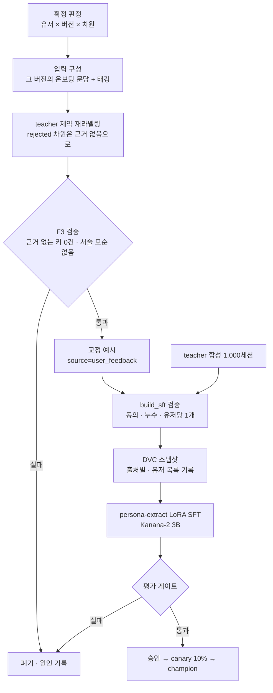
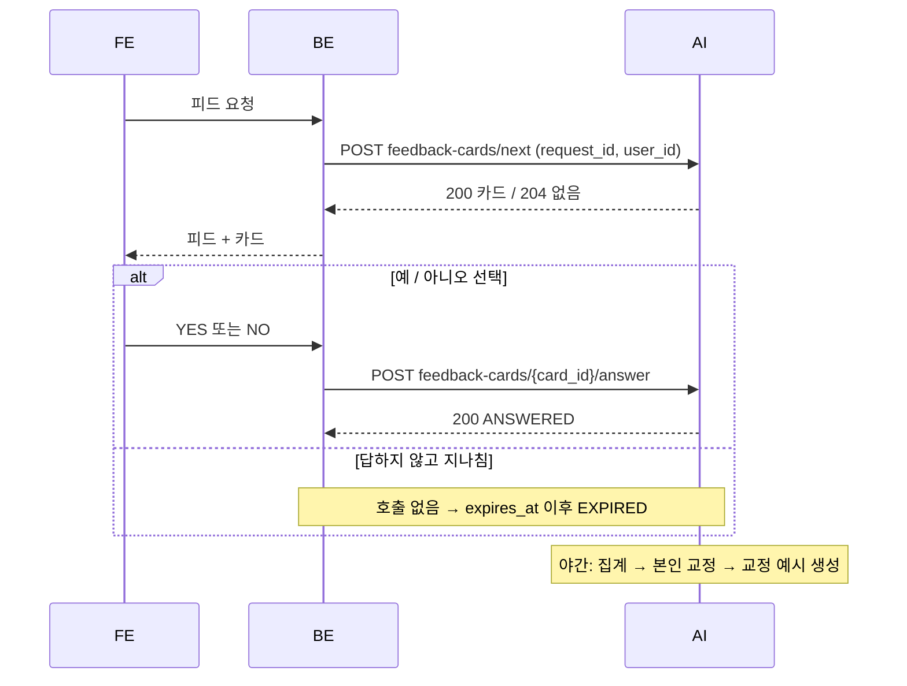

# 페르소나 재현도 피드백 카드 — 추출 학습 설계

> 작성일: 2026-11-02 · 상태: 설계 초안 (팀 검토 전, 미구현)
> 대상 레포: `KTB4-17th-AI` (코드 근거는 dev 체크아웃 기준)
> 관련 문서: `페르소나_피드백_카드_활용_정리.md`, `serving/teacher/README.md`, `docs/성능평가/03_F3_페르소나_추출_평가기준서.md`

---

## 핵심 요약 (Executive Summary)

- **하려는 것**: 홈피드에 카드를 끼워 "내 페르소나가 다른 유저에게 이런 말을 했어요. 나다운 대답인가요? (예/아니오)"를 묻고, 그 응답으로 **페르소나 추출 모델(`persona-extract`)을 교정 학습**한다.
- **카드에 올리는 발화**: 사용자 A의 페르소나가 **실제 다른 유저와 나눈 연습 대화**(우선)와 시뮬레이션에서 한 말. 이미 AI DB에 저장돼 있어 BE에서 받아올 필요가 없다.
- **발화 선택의 핵심 기준**: 그 발화가 드러내는 성향이 **추출 결과에서 실제로 프롬프트에 들어간 차원**(점수 65 이상 또는 35 이하)이고, **발화 방향이 추출 점수 방향과 같아야** 한다. 그래야 "아니오"가 추출의 오류라고 말할 수 있다.
- **학습 방식**: 응답을 유저 × 차원 단위로 모아 확정한 뒤, "예"는 점수 유지, "아니오"는 해당 차원을 비운(null) 교정 정답을 만든다. teacher를 "그 차원은 근거 없음" 제약으로 다시 돌려 서술까지 일관된 JSON을 만들고, 기존 teacher 합성 데이터에 소량 섞어 LoRA SFT를 한다.
- **기대 효과와 한계**: 모델은 "근거가 약하면 단정하지 않는다"를 배운다. 정밀도(근거 없는 특성 감소)는 오를 수 있지만, "아니오"는 맞는 값을 알려 주지 않으므로 정확도 자체를 올리지는 못하고 커버리지는 조금 내려간다.
- **효과가 나타나는 곳**: 응답한 사용자 본인은 확정 즉시 프로필이 교정되고(학습 불필요), 신규 사용자는 재학습된 추출 모델로 온보딩부터 덜 단정적인 페르소나를 받는다.
- **BE에 필요한 API**: 카드 받기(`POST next`), 응답 보내기(`POST answer`, 예/아니오만) 두 개뿐이다. 선택 로직은 전부 AI가 맡고 BE는 노출 위치·동의·표시만 담당한다.
- **선행 조건**: teacher(Qwen3.8-27B) 골드셋 검증 통과, `training/extraction/` 신규 작성, `feedback_cards` 테이블·라우터·야간 집계 잡 구현, 학습 활용 동의 약관.

---

## 1. 전제와 한계

### 1.1 이 데이터가 추출에 주는 정보

| 응답 | 알려 주는 것 | 알려 주지 않는 것 |
|---|---|---|
| 예 | 현재 추출값이 본인 인식과 맞다 | 새 정보 없음 (기존 값 확인) |
| 아니오 | 현재 추출값이 본인 인식과 다르다 | 맞는 값이 무엇인지 |

따라서 교정은 **"아니오 → 그 차원을 비운다(null)"**로만 한다. 값을 지어내지 않는 F3의 C4 원칙(근거 없는 차원은 키 생략)과 같은 방향이다.

### 1.2 지표별 기대 방향

| 지표 | 방향 | 설명 |
|---|---|---|
| 정밀도 (근거 없는 특성 생성 감소) | ↑ 가능 | 교정이 겨냥하는 대상 |
| 정확도 (맞는 값을 맞히기) | 변화 없음 | 맞는 값을 모르는 신호 |
| 커버리지 (채워지는 차원 수) | ↓ | 비우는 학습이므로 |
| 기존 F3 지표 | 유지 목표 | 깨지지 않게 지키는 대상 |

### 1.3 응답이 곧 진실은 아니다

- 덜 좋아 보이는 특성은 사실이어도 "아니오"가 나올 수 있다 (이상적 자아 편향).
- 실수 클릭, 발화의 말투 때문에 생긴 "아니오"도 섞인다.
- 그래서 한 번의 응답으로 라벨을 바꾸지 않고, 여러 응답을 모아 확정한다 (4장).

---

## 2. 현재 코드 근거

| 항목 | 위치 | 내용 |
|---|---|---|
| 추출 출력 스키마 | `app/features/persona/schemas.py` `RawExtraction` | 15개 점수 차원(0~100) + interests·routine·date_prefer·date_avoid + narrative + summaries. 근거 없는 차원은 키 없음 |
| 저장 형태 | `app/features/persona/models.py` `PersonaRecord` | `scores`(15키, 모름은 null), `confidence`(LOW·MEDIUM·HIGH), `texts`, `narrative`, `summaries`, `conversation_style`, `version`, `previous_id` |
| 프롬프트 반영 규칙 | `app/features/persona/profile.py` `describe()`·`trait_lines()` | 점수 ≥ 65(`HIGH_FROM`)는 high 문장, ≤ 35(`LOW_TO`)는 low 문장, 36~64와 null은 제외, confidence LOW는 "(근거 부족 — 약하게만)" |
| 연습 대화 저장 | `app/features/practice/models.py` | `practice_sessions.partner_persona_id`(말하는 페르소나의 특정 버전), `partner_user_id`, `practice_messages.role`(user·persona), `source`(llm·fallback) |
| 시뮬레이션 저장 | `app/features/simulation/models.py` | `simulations.persona_a_id`·`persona_b_id`(특정 버전), `transcript` [{index, speaker, text}] |
| teacher | `serving/teacher/README.md` | Qwen3.8-27B(커밋 `1d4bf0f`), RunPod H100 + vLLM 0.30.0, thinking 끔 |
| 페르소나 출처 값 | `PersonaResponse.source` | `llm`·`fallback`·`practice`·`kakao`·`reset` — 피드백 교정용 값은 아직 없음 |

> 시뮬레이션은 `/v1/simulation_old` 기준 테이블로 확인했다. 현재 쓰는 v2 시뮬레이션의 저장 위치는 확인이 필요하다.

---

## 3. 카드에 올릴 발화 선택

### 3.1 발화 출처

| 우선 | 출처 | A의 페르소나 발화 조건 | 당시 페르소나 버전 |
|---|---|---|---|
| 1 | 연습 대화 (실제 유저 B가 A의 페르소나와 대화) | `practice_messages.role = 'persona'`, `source = 'llm'`, 세션의 `partner_user_id = A` | `practice_sessions.partner_persona_id` |
| 2 | 시뮬레이션 (A 페르소나와 B 페르소나의 대화) | `transcript`에서 A 쪽 화자의 줄 | `persona_a_id` 또는 `persona_b_id` |

연습 대화를 우선하는 이유: 실제 사람을 상대로 한 발화라서 "다른 유저에게 한 말"이라는 카드 설명과 정확히 맞는다.

### 3.2 차원 연결

후보 발화마다 F2 태거를 돌려 **어느 차원을 어느 방향(높음/낮음)으로 드러내는지** 붙인다.

```json
{
  "utterance": "주말엔 보통 혼자 시간 보내는 편이에요",
  "tag": {"dimension": "avoidance", "direction": "high", "tag_confidence": "HIGH"}
}
```

> F2 태거는 지금까지 온보딩 답변에만 써 왔다. 대화체 발화에서의 정확도는 측정한 적이 없으므로, 도입 전에 클론 발화 소량(예: 100~200줄)을 사람이 라벨링해 태거 정확도를 따로 잰다.

### 3.3 제외 조건 (하나라도 걸리면 버림)

| # | 조건 | 이유 |
|---|---|---|
| E1 | `source = 'fallback'` | 추출과 무관한 기본 응답 |
| E2 | 첫 인사, 마무리 인사·다음 약속 줄 | 성향이 드러나지 않음 |
| E3 | 10자 미만 (예: "네 좋아요") | 판단 근거 없음 |
| E4 | 태거가 차원을 못 잡음, 또는 태깅 confidence LOW | 응답을 차원에 연결할 수 없음 |
| E5 | 태깅된 차원이 당시 페르소나에서 **36~64(중간) 또는 null** | 이 차원은 프롬프트에 들어가지 않았다. 발화에 드러났다면 생성 모델이 지어낸 것이지 추출 결과가 아니다 |
| E6 | **발화 방향 ≠ 페르소나 점수 방향** (점수는 낮음인데 발화는 높음 쪽 등) | 생성이 추출값을 따르지 않은 경우. 추출 학습에서 제외하고 F4·F5 품질 로그로 보낸다 |
| E7 | 상대(B)의 이름·사실(`B-f*`)·발화를 담은 줄 | 상대방 개인정보 노출 |
| E8 | 당시 페르소나 버전 ≠ A의 현재 페르소나 버전 | 이미 바뀐 프로필에 대한 판정이 됨 |
| E9 | 이미 노출한 발화와 임베딩 유사도가 높음 (KURE-v1, 임계값 τ) | 중복 질문 |
| E10 | 가드레일 차단·민감 주제에서 나온 줄 | 노출 부적절 |

E5·E6이 이 설계의 핵심이다. 둘을 통과한 발화에서 나온 "아니오"만 **추출의 오류**로 볼 수 있다.

### 3.4 우선순위 (선택 지표)

남은 후보를 아래 순서로 정렬해 하나씩 꺼낸다. 정렬은 카드를 꺼내는 시점의 상태로 계산한다(어제 확인한 차원은 오늘 순위가 내려가야 하므로).

| 순위 | 기준 | 이유 |
|---|---|---|
| P1 | 아직 카드로 한 번도 확인하지 않은 차원 | 차원마다 최소 1회 확인 |
| P2 | `confidence = LOW` 차원 (프롬프트에 "근거 부족 — 약하게만"으로 들어간 것) | 틀렸을 가능성이 가장 높음 |
| P3 | 극단값 (80 이상, 20 이하) | 판정이 분명하게 나옴 |
| P4 | 응답이 예/아니오로 갈려 미확정인 차원 | 확정하려면 추가 응답 필요 |
| P5 | 최신 대화에서 나온 발화 | 사용자가 맥락을 기억함 |
| 탐색 | 전체 요청의 약 20%는 후보 중 무작위 | 우선순위만 쓰면 특정 차원·성향으로 데이터가 치우침 |

### 3.5 노출 규칙

| 항목 | 값 (초안) |
|---|---|
| 유저당 하루 최대 노출 | 2장 |
| 연속 노출 간격 | 6시간 이상 |
| 같은 날 같은 차원 | 1회까지 |
| 카드 만료 | 생성 후 7일, 노출 후 24시간 내 무응답 시 만료 (건너뛰기 버튼은 없고, 답하지 않으면 만료로 처리) |
| 페르소나 재생성 시 | 이전 버전으로 만든 미노출 카드 전부 만료 |

### 3.6 언제 계산하나

| 작업 | 비용 | 시점 |
|---|---|---|
| 태깅, 제외 조건 E1~E10 검사 | 모델 호출이라 비쌈 | 대화 종료 후 (훅이 없으면 야간 배치) → `card_candidates` 저장 |
| 우선순위 정렬, 노출 상한, 중복 확인 | DB 조회라 쌈 | BE가 카드를 요청할 때 |

---

## 4. 응답 집계와 확정

### 4.1 확정 규칙 (야간 배치)

| 항목 | 규칙 (초안) |
|---|---|
| 집계 단위 | 유저 × 페르소나 버전 × 차원 |
| 사용하는 응답 | `YES`·`NO`. 답하지 않아 만료된 카드는 라벨로 쓰지 않음 |
| 확정 조건 | 직접 응답 2건 이상, 한쪽이 2/3 이상 |
| 유사 발화 약한 표 | 같은 유저·같은 차원에서 응답받은 발화와 임베딩이 τ 이상 가까운 미노출 발화는 0.5표. 약한 표만으로는 확정하지 않음 |
| 미확정 | 다음 카드 우선순위 P4로 올림 |

### 4.2 판정 상태

| 상태 | 의미 | 후속 |
|---|---|---|
| `confirmed` | 예로 확정 | 점수 유지, 학습 정답에 "확인됨" |
| `rejected` | 아니오로 확정 | 본인 프로필에서 비우고, 학습 정답에서 키 삭제 |
| `pending` | 응답 부족 또는 갈림 | 추가 카드 |

### 4.3 품질 필터

- **재노출 일관성**: 같은 발화를 시간차를 두고 다시 보여 줬을 때 답이 바뀌는 유저는 신뢰도를 낮춘다.
- **방향별 비대칭**: 같은 차원에서 "높음" 방향 발화와 "낮음" 방향 발화의 아니오 비율 차이가 크면, 그 차원은 사람 확인 전까지 학습에서 제외한다 (이상적 자아 편향 감지).
- **유저당 상한**: 한 유저의 판정은 학습 예시 1개로만 반영한다.

---

## 5. 교정 학습

### 5.1 전체 흐름



### 5.2 교정 예시 만들기 (유저 1명당 1개)

**입력**: 그 페르소나 버전을 만든 온보딩 세션의 문답과 태깅 결과. 지금 추출 프롬프트에 들어가는 입력과 같다.

**정답**:

| 차원 상태 | 정답에서의 처리 |
|---|---|
| `confirmed` | 원래 점수 유지 |
| `rejected` | 키 삭제 (null) |
| 미확정 | teacher 라벨 |
| 목록 항목 (관심사 등) 중 rejected | 해당 항목 삭제 |

**제약 재라벨링**: 점수 키만 지우면 `narrative`·`traits`·`summaries`에 그 성향 서술이 남아 점수와 모순된다. 그래서 같은 입력으로 teacher를 한 번 더 돌린다. 이때 프롬프트에 "다음 차원은 근거 없음으로 처리하고 서술에도 쓰지 않는다: [rejected 차원 목록]"을 추가하고, confirmed 차원 값은 고정값으로 넘긴다. 결과가 F3 검증을 통과해야 정답으로 쓴다.

| 검증 | 기준 |
|---|---|
| rejected 차원 키 | 없어야 함 |
| confirmed 차원 값 | 원래 값과 같은 구간 (낮음 0~34 · 중간 35~64 · 높음 65~100) |
| 서술-점수 모순 | 없음 (현재 service의 모순 검사 재사용) |
| `unknownScores` | 근거 없는 차원 키 0건 |

### 5.3 예시 레코드

```json
{
  "example_id": "fb_u_A_v3",
  "source": "user_feedback",
  "user_id": "u_A",
  "persona_id": "p_7f3a...",
  "persona_version": 3,
  "consent_basis": "terms-2026-11",
  "reviewed_by": "self",
  "input": {
    "session_id": "s_91c2...",
    "turns": [{"question": "...", "answer": "...", "tags": {"primary": ["avoidance"]}}]
  },
  "verdicts": {"avoidance": "confirmed", "openness": "rejected", "disclosure": "pending"},
  "target": {
    "avoidance": 78,
    "seriousness": 80,
    "interests": ["전시", "러닝"],
    "narrative": {"headline": "...", "body": "...", "traits": ["..."]}
  },
  "rejected_output": {"avoidance": 78, "openness": 22, "seriousness": 80, "...": "..."}
}
```

- `target`에서 `openness` 키가 없는 것이 교정이다.
- `rejected_output`은 당시 추출 출력이다. DPO를 쓸 때 rejected 쪽으로 쓴다.

### 5.4 학습 데이터 구성

| 출처 | 비중 | 처리 |
|---|---|---|
| teacher 합성 (`data/synthetic/sub-1000-rewritten`, 997세션) | 기반 | 기존 `label_with_teacher.py` 결과 |
| 카드 교정 예시 | 소량 | 2~3배 오버샘플, 유저당 1개 |
| (선택) DPO 선호쌍 | 교정 예시 수만큼 | chosen = `target`, rejected = `rejected_output` |

- **유저 단위 분리**: 같은 유저의 예시가 학습과 평가에 동시에 들어가지 않게 한다.
- **출처 분리**: 스냅샷 안에서 출처별로 나눠, 결과가 나빠지면 어느 출처 때문인지 추적한다.
- **유저 목록 기록**: 스냅샷마다 포함된 유저 목록을 남겨, 탈퇴·철회 유저를 다음 학습에서 뺀다.

### 5.5 학습 설정

| 항목 | 값 |
|---|---|
| student | Kanana-2 3B (`kakaocorp/kanana-2-3b-instruct@6a5d788`) |
| 방식 | LoRA SFT (DPO는 SFT 결과를 본 뒤 선택) |
| 출력 | `persona-extract-vN` 어댑터 |
| 추적 | MLflow run에 데이터 스냅샷 해시, git sha, 출처별 예시 수 기록 |
| 재학습 트리거 | 확정 교정 예시 N건 초과 (첫 2회는 수동 실행 후 N 결정) |

### 5.6 평가 게이트

평가는 **학습에 들어가지 않은 유저**로 한다. candidate와 champion을 같은 평가셋으로 함께 돌린다.

| 게이트 | 지표 | 기준 |
|---|---|---|
| 사전 | 실제 응답 모델 = 평가 대상 (폴백 0건) | 필수 |
| 0 계약 | 스키마 유효성 | 100% |
| 1 치명 | `unknownScores` (근거 없는 차원 점수, E3-CRIT-01) | 0건 |
| 3 품질 | `acceptableRanges` (기존 F3 골드셋) | 80% 이상, champion 대비 하락 없음 |
| 교정 | 교정 반영률 (rejected 차원을 비운 비율) | champion보다 높음 |
| 교정 | 확정값 보존율 (confirmed 차원을 같은 구간으로 유지한 비율) | champion 대비 유지 |
| 과잉 방지 | 차원 커버리지 (null이 아닌 차원 비율) | champion 대비 크게 하락하지 않음 |
| 편향 | 응답 수 구간별 (1~2건 / 3~9건 / 10건 이상) | 적게 응답한 구간에서 하락 없음 |

- 모든 지표는 **모델 원본 JSON 기준**으로 잰다. service 후처리 뒤의 제품 점수는 미답변 차원을 사후 null로 정리하므로 교정 효과가 가려진다 (F3 기준서 1.2절).

### 5.7 운영 canary

| 지표 | 계산 | 승격 조건 |
|---|---|---|
| 카드 예 비율 | 유저 단위 평균 (응답 건수 합산 아님) | champion보다 낮지 않음 |
| 유저당 예 확정 차원 수 | 유저 평균 | 유지 |
| 생성 원인 비율 | E6으로 걸러진 발화 비율 | 변화 없음 |

예 비율만 보면 함정이 있다. 새 모델이 차원을 많이 비우면 비운 차원은 카드 후보(E5)에서 빠지고, 확신 있는 차원만 카드로 나가 예 비율이 저절로 오른다. 그래서 확정 차원 수를 함께 본다.

---

## 6. 응답한 사용자 본인의 즉시 교정

학습과 별개로, 판정이 확정되면 A의 프로필을 바로 고친다.

| 단계 | 처리 |
|---|---|
| 1 | `rejected` 차원을 null로, 관련 목록 항목 삭제 |
| 2 | narrative·traits·summaries에서 해당 성향 서술 제거 (teacher 제약 재생성 또는 규칙 필터) |
| 3 | 새 `PersonaRecord` 버전 생성 (`previous_id` 연결, `changes`에 기록) |
| 4 | 이전 버전으로 만든 미노출 카드 만료 |

- `PersonaResponse.source`에 `feedback` 값을 추가해야 한다 (스키마 변경).
- 사용자에게 "카드 응답으로 페르소나가 업데이트됐어요" 같은 안내를 할지는 기획 결정이다.

---

## 7. 데이터 모델 (AI DB, 신규)

### 7.1 `feedback_card_candidates`

| 컬럼 | 타입 | 설명 |
|---|---|---|
| `id` | string PK | `card_id`로 노출 |
| `user_id` | string, index | 카드를 볼 유저 = 발화한 페르소나의 주인 |
| `persona_id` | string FK | 발화 당시 페르소나 버전 행 |
| `source_type` | enum | `practice` · `simulation` |
| `source_id` | string | `practice_messages.id` 또는 `simulations.id` + 줄 index |
| `utterance` | text | 노출 문장 (상대 정보 제거) |
| `dimension` | string | 태깅 차원 (FE에 노출 안 함) |
| `direction` | enum | `high` · `low` |
| `tag_confidence` | enum | `HIGH` · `MEDIUM` |
| `persona_score` | int | 당시 그 차원 점수 |
| `persona_confidence` | enum | 당시 그 차원 confidence |
| `embedding` | vector | 중복 확인용 (KURE-v1) |
| `status` | enum | `READY` · `SHOWN` · `ANSWERED` · `EXPIRED` |
| `shown_request_id` | uuid | `next` 재시도 시 같은 카드를 돌려주기 위한 키 |
| `question_version` | string | 노출한 질문 문구 버전 |
| `release_id` · `cohort` | string | 생성 당시 모델 조합 · canary 그룹 |
| `created_at` · `shown_at` · `expires_at` | datetime | |

### 7.2 `feedback_card_answers`

| 컬럼 | 타입 | 설명 |
|---|---|---|
| `card_id` | string FK, unique | 카드당 응답 1개 |
| `request_id` | uuid, unique | `answer` 재전송 식별 |
| `user_id` | string | |
| `answer` | enum | `YES` · `NO` |
| `answered_at` | datetime | |
| `consent_version` | string | 응답 시점 동의 약관 버전 → `consent_basis` |

### 7.3 `feedback_verdicts`

| 컬럼 | 타입 | 설명 |
|---|---|---|
| `user_id` · `persona_id` · `dimension` | 복합 PK | |
| `state` | enum | `confirmed` · `rejected` · `pending` |
| `yes_count` · `no_count` · `weak_votes` | number | |
| `decided_at` | datetime | |

---

## 8. 백엔드 API (BE → AI)

### 8.1 공통

기존 BE 연동 계약(`docs/v2docs/backend-api-contract.md`)과 `chat_end` 스키마 규칙을 따른다. 단 `request_id`는 기존 계약에 없어 이번에 새로 추가한다.

| 항목 | 값 |
|---|---|
| 호출 방향 | BE → AI (FE는 AI를 직접 부르지 않음) |
| Base path | `/ai/api` |
| 인증 | `X-Internal-Api-Key: <key>` |
| 형식 | `application/json`, 필드는 snake_case, enum은 대문자 |
| 모르는 필드 | `422`로 거절 (`extra="forbid"`) |
| 재시도 | 모든 POST에 `request_id`(UUID). 같은 값으로 다시 오면 같은 결과를 돌려준다 |
| 오류 본문 | `{ "detail": "오류 설명" }` |
| 시간 | ISO 8601, 타임존 포함 |

### 8.2 카드 문장 받기

`POST /ai/api/v1/feedback-cards/next`

- 호출 시점: BE가 피드를 구성할 때. **학습 활용에 동의한 유저**에 대해서만 호출한다.
- GET이 아니라 POST인 이유: 재시도 시 같은 `request_id`면 같은 카드를 돌려줘 노출이 두 번 기록되지 않게 한다.
- AI 처리: 우선순위 정렬 → 노출 상한 확인 → 1장 선택 → `status=SHOWN`, `shown_at`·`shown_request_id` 기록.

요청:
```ts
type FeedbackCardNextRequest = {
  request_id: string;   // UUID. 같은 값으로 다시 오면 같은 카드를 돌려준다
  user_id: string;      // 카드를 볼 유저 = 페르소나 주인
};
```
```json
{
  "request_id": "550e8400-e29b-41d4-a716-446655440010",
  "user_id": "user-1001"
}
```

응답 `200`:
```ts
type FeedbackCardResponse = {
  card_id: string;
  utterance: string;          // 화면에 보여줄 페르소나 문장 (상대 정보 제거됨)
  question: string;           // 화면에 보여줄 질문 문구
  question_version: string;   // 문구 버전. 바뀌면 응답 분포가 달라져 기록한다
  expires_at: string;         // 이 시각 이후 응답은 409
};
```
```json
{
  "card_id": "fc_01JB8XQ2M4",
  "utterance": "주말엔 보통 혼자 시간 보내는 편이에요",
  "question": "내 페르소나가 다른 유저에게 한 말이에요. 나다운 대답인가요?",
  "question_version": "Q1",
  "expires_at": "2026-11-03T21:00:00+09:00"
}
```

응답 `204`: 보여줄 카드가 없다 (후보 없음, 노출 상한 도달, 신규 유저 등). 본문 없음. BE는 카드를 띄우지 않는다.

- `dimension`·`direction`은 내려주지 않는다. 화면에 성향 이름이 보이면 응답이 그쪽으로 유도된다.
- 질문 문구는 AI가 내려준다. 문구가 바뀌면 응답 분포가 달라지므로 `question_version`으로 관리한다.

### 8.3 사용자 답변 보내기

`POST /ai/api/v1/feedback-cards/{card_id}/answer`

- 답변은 **예(`YES`) / 아니오(`NO`) 두 가지뿐**이다. 건너뛰기 선택지는 없다.
- 사용자가 답하지 않고 카드를 지나치거나 닫으면 BE는 이 API를 호출하지 않는다. 카드는 `expires_at`이 지나면 AI가 `EXPIRED`로 바꾸고 라벨로 쓰지 않는다.

요청:
```ts
type FeedbackCardAnswerRequest = {
  request_id: string;        // UUID. 같은 값 재전송은 같은 결과
  user_id: string;           // 카드 주인과 같아야 한다
  answer: "YES" | "NO";
  answered_at: string;
  consent_version: string;   // 응답 시점에 동의한 약관 버전 → 학습 근거(consent_basis)
};
```
```json
{
  "request_id": "550e8400-e29b-41d4-a716-446655440011",
  "user_id": "user-1001",
  "answer": "NO",
  "answered_at": "2026-11-02T21:14:03+09:00",
  "consent_version": "terms-2026-11"
}
```

응답 `200`:
```ts
type FeedbackCardAnswerResponse = {
  card_id: string;
  status: "ANSWERED";
};
```
```json
{ "card_id": "fc_01JB8XQ2M4", "status": "ANSWERED" }
```

### 8.4 오류 코드

| HTTP | 경우 | 해당 API |
|---|---|---|
| `401` | 내부 API 키 불일치 | 전체 |
| `403` | `user_id`가 카드 주인과 다름 | answer |
| `404` | 없는 `card_id` | answer |
| `409` | 이미 다른 `request_id`로 응답함, 또는 만료된 카드 | answer |
| `422` | 필수 필드 누락, 모르는 필드, enum 값 오류 (`SKIP` 등) | 전체 |

### 8.5 JSON Schema

BE에 넘기는 파일: [`feedback_cards.schema.json`](feedback_cards.schema.json) (JSON Schema 2020-12). 예시 JSON은 아래 Pydantic 모델로 검증을 통과했다.

| 스키마 | 쓰는 곳 | 필수 필드 | 제약 |
|---|---|---|---|
| `FeedbackCardNextRequest` | `next` 요청 | `request_id`, `user_id` | 다른 필드가 있으면 422 |
| `FeedbackCardResponse` | `next` 응답 200 | `card_id`, `utterance`, `question`, `question_version`, `expires_at` | `utterance` 1~300자, `question` 1~200자, `question_version` 1~32자 |
| `FeedbackCardAnswerRequest` | `answer` 요청 | `request_id`, `user_id`, `answer`, `answered_at`, `consent_version` | `answer`는 `YES` · `NO`만, `consent_version` 1~64자, 다른 필드가 있으면 422 |
| `FeedbackCardAnswerResponse` | `answer` 응답 200 | `card_id`, `status` | `status`는 `ANSWERED` 고정 |
| `ErrorResponse` | 401 · 403 · 404 · 409 | `detail` | 문자열 |
| `ValidationErrorResponse` | 422 | `detail` | FastAPI 기본 형식(배열) |

공통 타입:

| 타입 | 형식 |
|---|---|
| `RequestId` | UUID 문자열 (`8-4-4-4-12`) |
| `UserId` | 문자열 1~64자, 앞뒤 공백 제거 |
| `CardId` | 문자열 1~64자 |
| 시각 | ISO 8601 `date-time`, 타임존 포함 |

422 응답 예시 (`answer`에 `SKIP`을 보낸 경우):

```json
{
  "detail": [
    {
      "type": "enum",
      "loc": ["body", "answer"],
      "msg": "Input should be 'YES' or 'NO'",
      "input": "SKIP",
      "ctx": { "expected": "'YES' or 'NO'" }
    }
  ]
}
```

### 8.6 AI 쪽 Pydantic 모델

```python
from datetime import datetime
from enum import StrEnum
from typing import Annotated, Literal
from uuid import UUID

from pydantic import BaseModel, ConfigDict, Field, StringConstraints

UserId = Annotated[str, StringConstraints(strip_whitespace=True, min_length=1, max_length=64)]


class FeedbackAnswer(StrEnum):
    YES = "YES"
    NO = "NO"


class _Request(BaseModel):
    model_config = ConfigDict(extra="forbid", str_strip_whitespace=True)


class FeedbackCardNextRequest(_Request):
    request_id: UUID
    user_id: UserId


class FeedbackCardResponse(BaseModel):
    card_id: str = Field(min_length=1, max_length=64)
    utterance: str = Field(min_length=1, max_length=300)
    question: str = Field(min_length=1, max_length=200)
    question_version: str = Field(min_length=1, max_length=32)
    expires_at: datetime


class FeedbackCardAnswerRequest(_Request):
    request_id: UUID
    user_id: UserId
    answer: FeedbackAnswer
    answered_at: datetime
    consent_version: str = Field(min_length=1, max_length=64)


class FeedbackCardAnswerResponse(BaseModel):
    card_id: str = Field(min_length=1, max_length=64)
    status: Literal["ANSWERED"]
```

- `UserId`는 `app/features/chat_end/schemas.py`와 같은 제약이다.
- `request_id`는 기존 계약에 없던 필드라 이번에 새로 둔다. 타입은 `UUID`.
- 카드 내부 상태(`READY` · `SHOWN` · `ANSWERED` · `EXPIRED`)는 DB 컬럼에만 쓰고 API로는 `ANSWERED`만 내려간다.

### 8.7 BE가 할 일

| 항목 | 내용 |
|---|---|
| 동의 | 약관에 "카드 응답의 AI 학습 활용" 항목 추가, 동의 유저만 `next` 호출 |
| 피드 위치 | 예: 피드 5번째 이후, 10개마다 최대 1장 |
| 화면 | `utterance`와 `question`, 예/아니오 버튼만 표시. 버튼 순서 고정 |
| 응답 전달 | 예·아니오를 누르면 `answer` 호출. 답하지 않고 지나치면 호출하지 않음 |
| 프로필 조회 | 본인 교정으로 페르소나 버전이 바뀌므로 `/my/persona`는 AI에서 최신 버전 조회 |

### 8.8 호출 순서



---

## 9. 개인정보·동의·삭제

| 항목 | 규칙 |
|---|---|
| 동의 | 응답마다 `consent_version` 저장, 학습 데이터의 `consent_basis`로 사용. 없으면 학습 제외 |
| 상대방 보호 | 카드에는 A 페르소나의 한 문장만. 상대 이름·사실·발화가 들어간 줄은 후보에서 제외(E7) |
| 삭제 | 카드 전용 삭제 API는 두지 않는다. 탈퇴 유저는 AI DB의 기존 유저 삭제 처리에 카드 테이블을 함께 묶고, 다음 재학습 스냅샷에서 제외한다 |
| 보존 기간 | 응답·판정 보존 기간은 기획·법무와 결정 |
| 접근 | 카드 응답 원본은 AI DB에만, 학습 스냅샷은 S3·DVC 권한 범위 안에서만 |

---

## 10. 모니터링 지표

| 지표 | 의미 | 쓰는 곳 |
|---|---|---|
| 카드 노출 수 · 응답률 | 묻는 방식이 부담스럽지 않은지 | 노출 상한 조정 |
| 무응답 만료 비율 | 노출됐지만 답하지 않은 카드 비율. 질문이 어렵거나 귀찮은지 | 문구·위치 조정 |
| 차원별 아니오 확정률 | 추출이 어느 차원에서 자주 단정하는지 | 온보딩 질문 보강, 학습 우선순위 |
| 생성 원인 비율 (E6 비율) | 추출이 아니라 생성 문제인 비율 | 대화 프롬프트 개선 |
| 재노출 일관성 | 같은 문장에 같은 답을 하는지 | 응답 신뢰도 필터 |
| 방향별 아니오 비대칭 | 이상적 자아 편향 | 차원 학습 제외 판단 |
| 유사 발화 표 정밀도 | 약한 표가 직접 응답과 일치하는지 | τ 조정 |
| 응답 수 분포 (유저별) | 소수 유저 쏠림 | 유저당 상한 조정 |

---

## 11. 선행 조건과 구현 범위

### 11.1 선행 조건

| 항목 | 상태 | 비고 |
|---|---|---|
| teacher 확정 | 미완 | Qwen3.8-27B가 `serving/teacher/README.md` 3절 기준 통과 필요 (태깅 primary F1 0.85 이상, 형식 위반 0, 추출 범위 적중 23/24 이상·환각률 0.6% 이하, 추출 호출·파싱 실패 0). 현재 골드셋은 Claude 라벨 기준 |
| 추출 학습 코드 | 없음 | `training/extraction/` 신규 |
| 태거의 대화체 정확도 | 미측정 | 클론 발화 소량 사람 라벨링 |
| 학습 활용 동의 약관 | 없음 | 기획·법무 |

### 11.2 AI 쪽 구현 항목

| 항목 | 내용 |
|---|---|
| 테이블 | `feedback_card_candidates` · `feedback_card_answers` · `feedback_verdicts` (Alembic 마이그레이션) |
| 후보 생성 | 대화 종료 훅 또는 야간 배치: 태깅 + E1~E10 |
| 라우터 | `/v1/feedback-cards` (`next` · `answer`) |
| 야간 집계 잡 | 확정 판정, 본인 프로필 교정, 교정 예시 생성(teacher 제약 재라벨링) |
| 학습 파이프라인 | `training/extraction/` · `build_sft.py`에 `source=user_feedback` 조건 추가 |
| 평가 | `user_verified` 평가셋, 교정 반영률·보존율·커버리지 스크립트 |
| 스키마 | `PersonaResponse.source`에 `feedback` 추가 |

---

## 12. 결정이 필요한 것

| 항목 | 선택지 | 제안 |
|---|---|---|
| 후보 생성 시점 | 대화 종료 훅 / 야간 배치 | 훅이 있으면 훅, 없으면 야간 배치로 시작 |
| 확정 기준 | 응답 건수·비율 | 직접 2건 이상 · 2/3 이상 (첫 집계 후 조정) |
| 유사 발화 τ | 값 | 정밀도 측정 후 결정 |
| 본인 프로필 즉시 교정 | 반영 / 학습 라벨로만 | 반영 |
| 사용자 안내 | 교정 사실 알림 여부 | 기획 결정 |
| 학습 방식 | SFT / SFT + DPO | SFT 먼저, DPO는 비교 후 |
| 재학습 트리거 N | 건수 | 첫 2회 수동 후 결정 |
| 노출 상한·위치 | 하루 2장 · 피드 5번째 이후 | 초안 |
| 질문 문구 | 문구·버전 | 기획과 확정 후 고정 |
| 동의 방식 | 가입 약관 / 첫 카드 노출 시 | 기획·법무 |
| 응답 보존 기간 | 기간 | 기획·법무 |
| 탈퇴·동의 철회 전달 | 기존 유저 삭제 흐름 / 별도 API | 기존 흐름에 카드 테이블 포함. 동의 철회 시 BE가 `next`·`answer` 호출을 멈추고, 이미 받은 응답의 학습 제외 방법은 BE와 확인 |
| v2 시뮬레이션 발화 포함 | 포함 / 연습 대화만 | 저장 위치 확인 후 결정, 첫 버전은 연습 대화만 |
